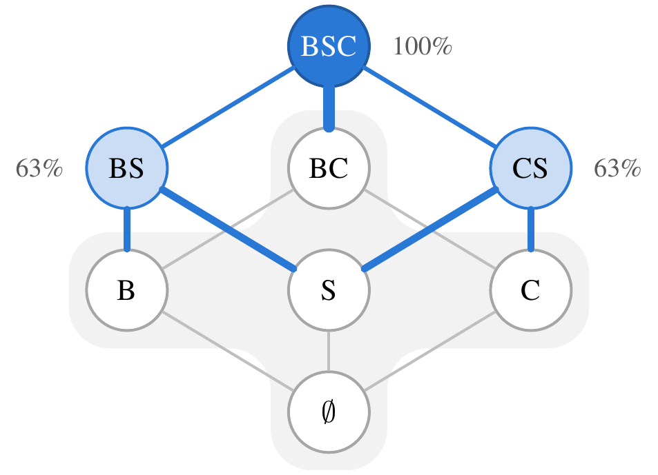
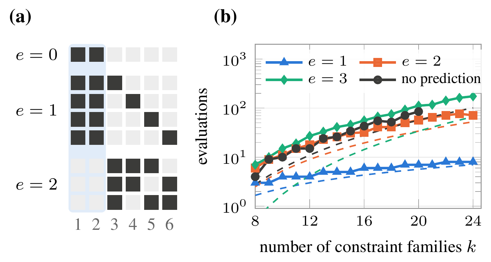
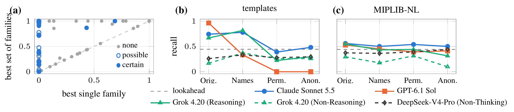
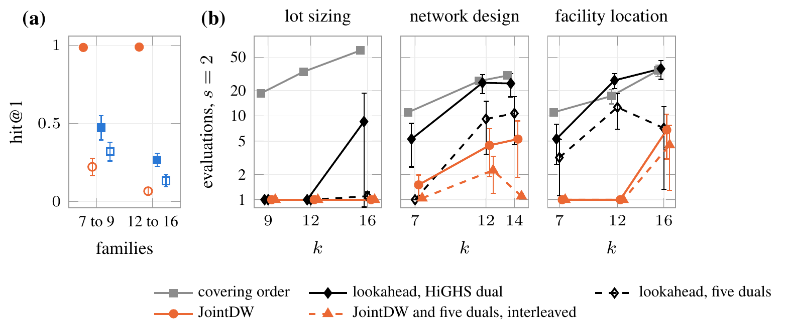
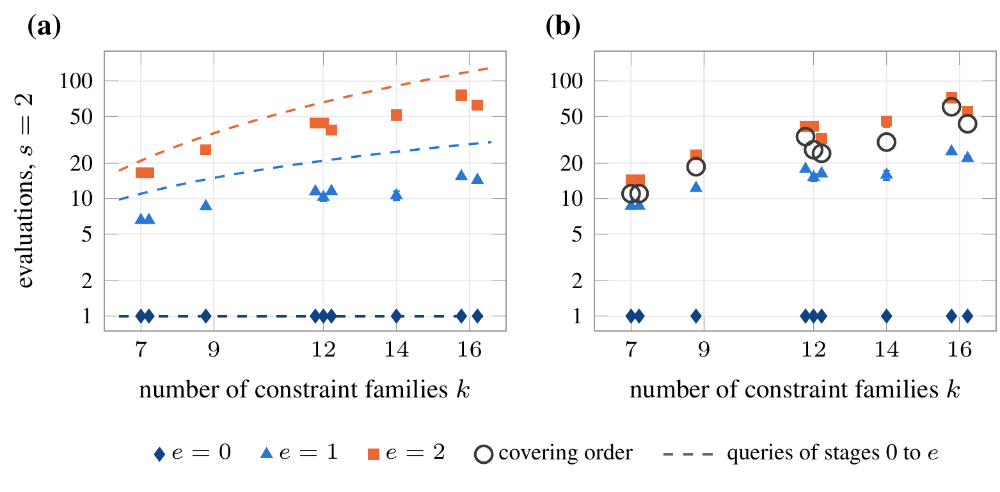

<div align="center">

<h1>Do Language Models Know Which Constraints Belong Together?</h1>

<p>
<b>Junbo Jacob Lian</b><sup>1,2,3</sup> &nbsp;·&nbsp;
<b>Kaixuan Chen</b><sup>3</sup> &nbsp;·&nbsp;
<b>Hanzhang Qin</b><sup>1</sup> &nbsp;·&nbsp;
<b>Huiling Chen</b><sup>4</sup> &nbsp;·&nbsp;
<b>Chaoyu Zhang</b><sup>5</sup> &nbsp;·&nbsp;
<b>Chung-Piaw Teo</b><sup>1</sup>
</p>

<p>
<sup>1</sup> Institute of Operations Research and Analytics, National University of Singapore<br>
<sup>2</sup> Wenzhou Buyi Pharmacy<br>
<sup>3</sup> McCormick School of Engineering, Northwestern University<br>
<sup>4</sup> College of Computer Science and Artificial Intelligence, Wenzhou University<br>
<sup>5</sup> Department of Decision Analytics and Operations, City University of Hong Kong
</p>

<p>
<a href="https://arxiv.org/abs/2611.05726"></a>
<a href="LICENSE"></a>
<a href="DATA.md"></a>
<a href="pyproject.toml"></a>
</p>



<p><i>Share of the integrality gap closed by every family-level Dantzig-Wolfe relaxation of a lot-sizing instance with two items and two periods (B: balance rows, S: setup rows, C: capacity rows). The shaded sets have gain zero, so a search that adds one family at a time never leaves the empty set, while the pairs BS and CS each close 63% of the gap.</i></p>

</div>

## Overview

Dantzig-Wolfe reformulation strengthens the linear relaxation of a mixed-integer program by convexifying a chosen set of constraint families, and every candidate costs a column generation run. The choice is hard when families strengthen the bound only together, because a search that adds one family at a time then stops at the linear relaxation. We call such a set of families a zero-marginal group.

This repository holds the code and data of the [paper](https://arxiv.org/abs/2611.05726):

- **Instances with exact gains**: small templates, 84 rich models with 7 to 16 constraint families, the census of zero-marginal groups in MIPLIB-NL, 59 standard lot-sizing, network-design and facility-location instances, and 76 generalized assignment and bin-packing instances without a joint group, with their gain tables and branch-and-price runs.
- **Predictions**: the prompts and the recorded answers of five language-model configurations under the presentations of each model, the one-pass lookahead at an optimal LP dual and its five-dual version, and a learned predictor trained on the gain tables.
- **Search**: JointDW, its interleaving with the lookahead, and the covering orders, with the latency and cost of every request.
- **Reproduction**: scripts that build every table and figure of the paper from the released data without calling any API.

## Main results

- **Prevalence.** Zero-marginal groups are common: three of ten MIPLIB-NL models whose bound can be improved have a certain one and another third a possible one, and on most of them no single family strengthens the bound at all. Every one of the 59 benchmark instances has one, and GCG's detector, which follows the block structure of the matrix, convexifies a set with no gain on 38 of them.
- **Theory.** When each evaluation may convexify at most *s* of *k* families, every method that observes only bounds needs a covering number of evaluations, of order *k*<sup>*w*</sup>, to find a hidden group of *w* families. A prediction that misses *e* members reduces the cost to Θ(*k*<sup>*e*</sup>) through one staged search that does not need to know *e*, and the search costs only a lower-order term more when the prediction is entirely wrong. With several groups the *r*-th best prediction sets the cost, and when an evaluation costs the *d*-th power of the number of convexified families the optimal cost is Θ(*k*<sup>min(*e*,*d*)</sup>).
- **JointDW.** The one-pass lookahead at an optimal LP dual vanishes on groups whose families share no variable. JointDW takes the prediction of a language model, verifies it with the staged search, and alternates it with the lookahead order, which delays each of the two orders by at most a factor of two.
- **Text prompts.** On MIPLIB-NL the strongest language models identify zero-marginal groups about as often as the lookahead and on partly different models. On textbook templates the predictions follow the names: with the family names permuted or anonymized, GPT-6.1 Sol finds no true group, and permuting the names lowers the recall of Grok 4.20 (Reasoning) and Claude Sonnet 5.5. Reasoning roughly doubles the accuracy of the same model.
- **Coefficients.** On the rich models, which place the classical group among further modeling features, GPT-6.1 Sol given every coefficient names a true group first in 249 of its 252 answers on models with 7 to 16 families, and on the models with 7 to 9 families also when the family names are permuted or replaced by labels. Interleaved with the five-dual lookahead, it needs 1.8 evaluations for pairs on the models with 12 to 16 families, where a covering needs 17 to 60. On the models with 7 to 9 families, a predictor trained on the gain tables of the same class is within sampling variation of JointDW for pairs, and its training labels cost 196 to 315 evaluations per class. Trained on other classes, it stays within sampling variation only with the lookahead value as a feature.
- **Misses.** The search cost follows the number of missed members. A prediction without a miss costs one evaluation. With one member of a pair missed, JointDW needs about four fifths of the evaluations of the covering order with seven families and about half with 16, and with both members missed about 1.3 times as many.
- **Branch-and-price.** On the benchmark instances the best pair is also the fastest set of at most two families for branch-and-price on 51 of the 59 instances. The sets chosen by the two language models take 1.3 and 1.4 times the time of the fastest set in geometric mean, against 1.7 times for the five-dual lookahead and 2.3 times for GCG's detector. On the 76 instances without a joint group, GPT-6.1 Sol names none.
- **Latency.** One answer takes 32 to 50 seconds for GPT-6.1 Sol and between 2.6 and 24 minutes for Claude Sonnet 5.5 with the text prompt, so a prediction pays for its latency only where evaluations are slow. On MIPLIB-NL, where an evaluation takes 43 seconds on average, the prediction of GPT-6.1 Sol pays once an evaluation takes more than 28 seconds.

<p align="center"></p>

*Figure 2. (a) Queries of the staged search for k = 6, s = 3, w = 2 and the prediction P = {1, 2}: the queries of stage e contain every hidden group with e members outside P, so a correct prediction is confirmed by the first query. (b) Evaluations to find a hidden group of w = 3 families with s = 6, for predictions that miss e members and without a prediction, with the lower bounds as dashed lines.*

<p align="center"></p>

*Figure 3. (a) Census of MIPLIB-NL: for each model with a positive gain, the largest gain of a single family against the largest gain of a set of families, both as shares of the LP gap; marks on the vertical axis have no family that strengthens the bound alone, and blue marks have a zero-marginal group at the empty set. (b, c) Recall of true joint supports under the four presentations on the templates and on MIPLIB-NL; the dashed line is the recall of the lookahead order.*

<p align="center"></p>

*Figure 4. Rich models with 7 to 16 families. (a) hit@1 of GPT-6.1 Sol (circles) and Claude Sonnet 5.5 (squares) given the text (open) and every coefficient (filled), on the models with 7 to 9 and with 12 to 16 families. (b) Mean evaluations until a best set is evaluated at s = 2 against the number of families k, for lot sizing, network design and facility location: covering order, lookahead order at the HiGHS dual and with five duals, JointDW with GPT-6.1 Sol given every coefficient, and JointDW interleaved with the five-dual lookahead. Bars: one standard error.*

<p align="center"></p>

*Figure 5. Search cost on the rich models at s = 2, by the number e of members of a best pair that the prediction misses, with one mark per class and number of families k. (a) The staged order alone, with the number of queries of stages 0 to e as dashed lines. (b) JointDW and the covering order. Bars: one standard error.*

## Installation

The code needs Python 3.13.

```bash
git clone https://github.com/junbolian/JointDW.git
cd JointDW
python3.13 -m venv .venv && source .venv/bin/activate
pip install -e ".[learned]"     # all that reproducing the tables and figures needs
pip install -e ".[test]"        # the tests, with every other extra
```

| Extra | Packages | Used for |
|---|---|---|
| none | NumPy 2.5.4 | the package |
| `learned` | xgboost-cpu 3.4.1, scikit-learn 1.9.1, SciPy 1.18.1 | the learned predictor |
| `solvers` | highspy 1.15.1, python-flint 0.9.0, SymPy 1.14.0 | exact gain tables and the lookahead |
| | PySCIPOpt 6.0.0, PyGCGOpt 1.0.0b0 on SCIP 10 | column generation evaluations, benchmark instances, branch-and-price |
| | gurobipy 13.0.3, pandas 2.2.3 | exporting the MIPLIB-NL models |
| `test` | pytest 9.2.0 and both other extras | the tests |

## Data

```bash
scripts/fetch_data.sh
```

downloads `jointdw_data_v1.2.tar.gz` (117.6 MB), the asset of the release [v1.2](https://github.com/junbolian/JointDW/releases/tag/v1.2), into `data/` and checks the SHA-256 recorded in the script. The release supersedes v1.1.1, v1.1 and v1.0. The archive holds:

- the instances and their gain tables: templates, rich models, MIPLIB-NL, benchmark instances, generalized assignment and bin packing;
- the lookahead values at one and at five duals;
- every recorded request and response, the rendered prompts, and the latency and cost records with the price list;
- the branch-and-price records and logs;
- the learned-predictor features;
- the results CSVs behind every table and figure.

[DATA.md](DATA.md) describes every part, how it was produced, the validity rules, the reference optima, the prices and the licenses.

Three parts are rebuilt from public sources and are not in the archive: the MPS files of the MIPLIB-NL models, the instance files built from public benchmark files, and the 405 user messages that embed a complete benchmark instance. [docs/INSTANCES.md](docs/INSTANCES.md) gives the commands. On a fresh clone, the rebuilt instance files are identical to the recorded ones (219 of 219 and 80 of 80), and so are the 405 messages.

## Reproducing the paper

```bash
scripts/reproduce.sh         # writes results/ and results/paper/
scripts/compare_results.sh   # compares them with data/reference_results/
```

`scripts/reproduce.sh` reads only `data/`, sends no request to a language model and needs no solver. It writes the table bodies and figure data of the paper to `results/paper/` and the result tables behind them to `results/`. [docs/OUTPUTS.md](docs/OUTPUTS.md) lists the result file of each of Figures 1 to 5 and Tables 1 to 30, the modules that the script runs, and the constants of the search costs and the bootstrap.

On a fresh clone (one workstation, Python 3.13), `scripts/compare_results.sh` found all 328 result files identical to the released ones.

| Step | Time |
|---|---|
| installation | 16 s |
| `scripts/fetch_data.sh` | 3 s |
| `scripts/fetch_benchmarks.sh` | 28 s |
| rebuilding and checking the instance files | 76 s |
| tests | 27 s |
| `scripts/reproduce.sh` | 66 min |

`tests/test_paper_tables.py` rebuilds every table body from the released results and compares it with the reference bodies in `tests/reference/`. With `JOINTDW_PAPER_TEX` set to the LaTeX source of the paper, it also compares every table body of the paper with these results.

## Running the language models

Every answer that the paper scores is in the released answer files, and every request has an entry in the released response cache, so reproducing the paper sends no request. A new run needs a key and a base URL for each provider, read from the environment variables listed in [`.env.example`](.env.example).

| Configuration | Provider | Endpoint identifier | Additional request fields |
|---|---|---|---|
| Claude Sonnet 5.5 | Anthropic | `claude-sonnet-5-5` | none |
| GPT-6.1 Sol | OpenAI | `gpt-6.1-sol` | `{"reasoning_effort": "medium"}` |
| Grok 4.20 (Reasoning) | xAI | `grok-4-20-reasoning` | none |
| Grok 4.20 (Non-Reasoning) | xAI | `grok-4-20-non-reasoning` | none |
| DeepSeek-V4-Pro (Non-Thinking) | DeepSeek | `deepseek-v4-pro` | `{"thinking": {"type": "disabled"}}` |

Each instance and presentation has three samples. The records contain:

| Prompt | Configurations | Instances |
|---|---|---|
| four presentations: original, names only, permuted, anonymized | all five | 15 templates, 102 scored MIPLIB-NL models |
| text, and every coefficient | all five | 24 rich models with 7 to 9 families |
| ranked variant | all five | 13 templates, 16 MIPLIB-NL models, 24 rich models |
| every coefficient with the names permuted or anonymized | GPT-6.1 Sol, Claude Sonnet 5.5 | 24 rich models with 7 to 9 families |
| text, and every coefficient | GPT-6.1 Sol, Claude Sonnet 5.5 | 60 rich models with 12 to 16 families |
| text, and every coefficient | GPT-6.1 Sol, Claude Sonnet 5.5 | 59 benchmark instances |
| text | GPT-6.1 Sol, Claude Sonnet 5.5 | 76 instances without a joint group |

With `MODEL` set to an endpoint identifier of the first table:

```bash
python -m llmdw.providers.smoke --config "$MODEL"
python -m llmdw.providers.support_run --config "$MODEL" --templates data/work/templates \
    --conditions original,names_only,permuted,anonymized --samples 3 --parallel 4 \
    --out "data/work/support_templates/$MODEL"
```

[docs/MODELS.md](docs/MODELS.md) gives the prompt files, the full description of the records, the command of every run, the run settings, and the replay check.

## Building instances

The released data make these steps unnecessary for reproducing the tables. [docs/INSTANCES.md](docs/INSTANCES.md) describes how each collection is built and gives the commands, and [docs/EXPERIMENTS.md](docs/EXPERIMENTS.md) gives the settings of every experiment. The solver runs are parts of `scripts/rerun.sh`: `benchmark`, `time_optimal`, `rich_models_large`, `no_joint_group`, `census`, `five_duals`, `large_models`, `reference_optima` and `eval_time`.

## Repository layout

```
llmdw/instances/   templates, rich-model generators, MIPLIB-NL export, family detection
llmdw/exact/       exact gain tables (HiGHS with rational verification in python-flint)
llmdw/lookahead/   one-pass lookahead at an optimal LP dual, and at five optimal duals
llmdw/search/      staged search, covering orders, interleaving, search cost
llmdw/prompts/     presentations, prompt rendering, answer parsing
llmdw/providers/   OpenAI-compatible client, cache, request records, replay check
llmdw/scoring/     hit@1, recall, bootstrap, census, result tables, learned predictor, cost accounting
llmdw/benchmark/   benchmark sources, standard formulations, ground truth, branch-and-price
llmdw/tables/      table bodies and figure data of the paper
llmdw/gcg/         GCG decompositions and bound evaluations
scripts/           fetch_data.sh, fetch_benchmarks.sh, reproduce.sh, compare_results.sh, rerun.sh
config/            request settings, benchmark sources, high-memory models
prompts/           system message, user template, ranked and data variants
tests/             offline tests and reference table bodies
docs/              OUTPUTS.md, MODELS.md, INSTANCES.md, EXPERIMENTS.md, figures of this README
```

[docs/OUTPUTS.md](docs/OUTPUTS.md#repository-layout-in-detail) lists the modules of each package.

## Citation

```bibtex
@misc{lian2026jointdw,
  title         = {Do Language Models Know Which Constraints Belong Together?},
  author        = {Lian, Junbo Jacob and Chen, Kaixuan and Qin, Hanzhang and Chen, Huiling and Zhang, Chaoyu and Teo, Chung-Piaw},
  year          = {2026},
  note          = {Preprint},
  eprint        = {2611.05726},
  archivePrefix = {arXiv},
  primaryClass  = {cs.LG},
  url           = {https://arxiv.org/abs/2611.05726}
}
```

## License

The code is released under the MIT License ([LICENSE](LICENSE)). The data are released under CC BY 4.0, except the parts derived from MIPLIB-NL (the model summaries, gain tables, lookahead values and census of the MIPLIB-NL models, and the MIPLIB-NL descriptions inside the prompts and records), which are released under CC BY-SA 4.0 as MIPLIB-NL is. When you use those parts, cite MIPLIB-NL (Li, Lu, Wei, Chen, Liu, Lan, Zhang and Wen, Constructing industrial-scale optimization modeling benchmark, arXiv:2602.10450, 2026) and MIPLIB 2017 (Gleixner et al., MIPLIB 2017: data-driven compilation of the 6th mixed-integer programming library, 2021, doi:10.1007/s12532-020-00194-3). [DATA.md](DATA.md) gives the license of each part.
