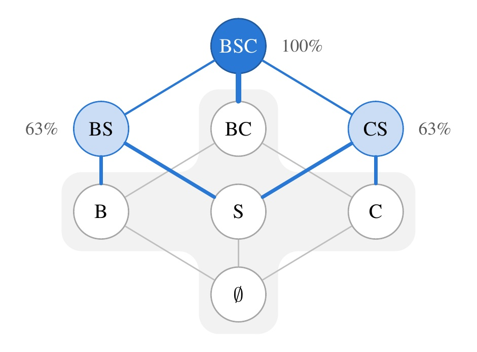
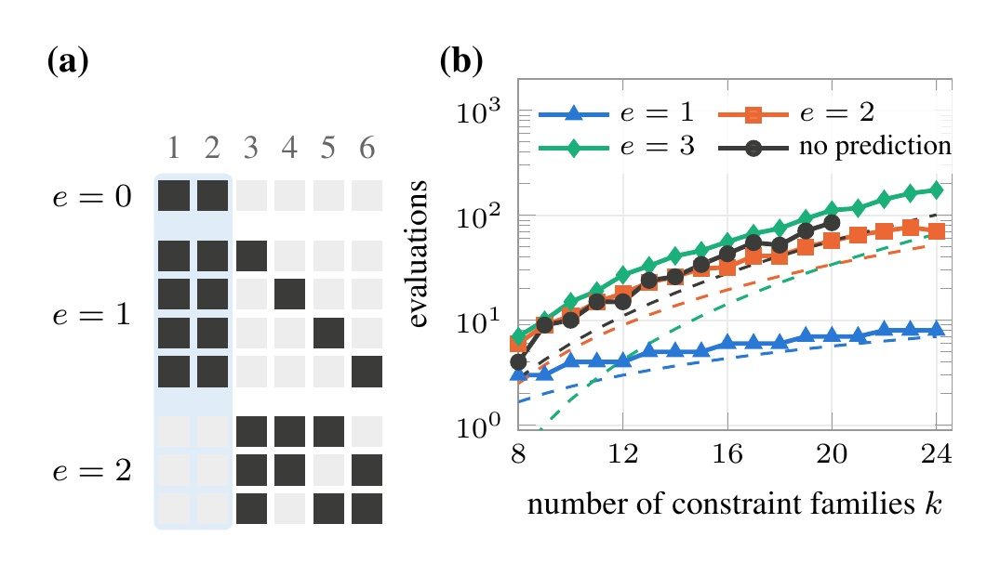
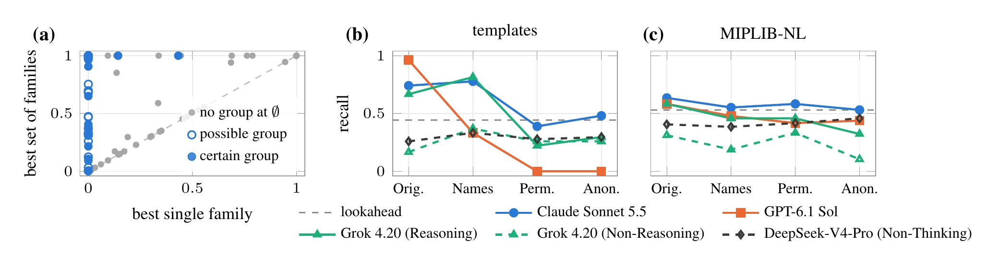
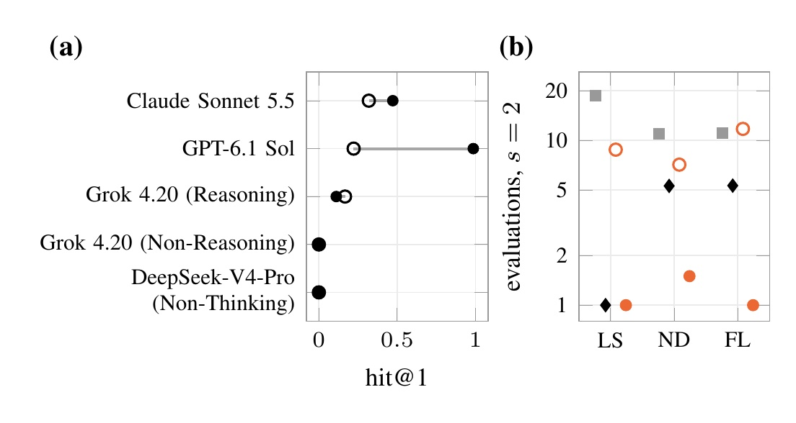

<div align="center">

<h1>Do Language Models Know Which Constraints Belong Together?</h1>

<p>
<b>Junbo Jacob Lian</b><sup>1,2,3</sup> &nbsp;·&nbsp;
<b>Kaixuan Chen</b><sup>3</sup> &nbsp;·&nbsp;
<b>Hanzhang Qin</b><sup>1</sup> &nbsp;·&nbsp;
<b>Huiling Chen</b><sup>4</sup> &nbsp;·&nbsp;
<b>Chaoyu Zhang</b><sup>5</sup> &nbsp;·&nbsp;
<b>Chung-Piaw Teo</b><sup>1</sup>
</p>

<p>
<sup>1</sup> Institute of Operations Research and Analytics, National University of Singapore<br>
<sup>2</sup> Wenzhou Buyi Pharmacy<br>
<sup>3</sup> McCormick School of Engineering, Northwestern University<br>
<sup>4</sup> College of Computer Science and Artificial Intelligence, Wenzhou University<br>
<sup>5</sup> Department of Decision Analytics and Operations, City University of Hong Kong
</p>

<p>
<a href="LICENSE"></a>
<a href="DATA.md"></a>
<a href="pyproject.toml"></a>
</p>



<p><i>Share of the integrality gap closed by every family-level Dantzig-Wolfe relaxation of a lot-sizing instance with two items and two periods (B: balance rows, S: setup rows, C: capacity rows). The shaded sets have gain zero, so a search that adds one family at a time never leaves the empty set, while the pairs BS and CS each close 63% of the gap.</i></p>

</div>

## Overview

Dantzig-Wolfe reformulation strengthens the linear relaxation of a mixed-integer program by convexifying a chosen set of constraint families, and every candidate costs a column generation run. The choice is hard when families strengthen the bound only together, because a search that adds one family at a time then stops at the linear relaxation. We call such a set of families a zero-marginal group. This repository holds the code and data of the paper: exact gain tables for small templates and for 24 rich models, the census of zero-marginal groups in MIPLIB-NL, the prompts and the recorded answers of five language-model configurations under four presentations of each model, the one-pass lookahead at an optimal LP dual, the search orders (JointDW, its interleaving with the lookahead, covering orders), and the scripts that build every table and figure of the paper from the released data without calling any API.

**Main results**

- Zero-marginal groups are common: a quarter of the MIPLIB-NL models whose bound can be improved have one, and on most of them no single family strengthens the bound at all.
- When each evaluation may convexify at most *s* of *k* families, every method that observes only bounds needs a covering number of evaluations, of order *k*<sup>*w*</sup>, to find a hidden group of *w* families. A prediction that misses *e* members reduces the cost to Θ(*k*<sup>*e*</sup>) through one staged search that does not need to know *e*, and the search costs only a lower-order term more when the prediction is entirely wrong.
- The one-pass lookahead at an optimal LP dual is blind to groups whose families share no variable. JointDW takes the prediction of a language model, verifies it with the staged search, and interleaves it with the lookahead at no more than twice the cost of the better of the two.
- On MIPLIB-NL the strongest language models identify zero-marginal groups about as often as the lookahead and on partly different models. On textbook templates their predictions rest on the names: permuting or anonymizing the family names removes them. Reasoning roughly doubles the accuracy of the same model.
- On the rich models, which place the classical group among further modeling features, the lookahead finds a best set with its first evaluation of three families. Language models given only the text seldom name the group; GPT-6.1 Sol given every coefficient names it in all but one answer and then needs fewer evaluations than the lookahead for pairs of families.

<p align="center"></p>

*Figure 2. (a) Queries of the staged search for k = 6, s = 3, w = 2 and the prediction P = {1, 2}: the queries of stage e contain every hidden group with e members outside P, so a correct prediction is confirmed by the first query. (b) Evaluations to find a hidden group of w = 3 families with s = 6, for predictions that miss e members and without a prediction, with the lower bounds as dashed lines.*

<p align="center"></p>

*Figure 3. (a) Census of MIPLIB-NL: for each model with a positive gain, the largest gain of a single family against the largest gain of a set of families, both as shares of the LP gap; blue marks have a zero-marginal group at the empty set. (b, c) Recall of joint supports under the four presentations, with the recall of the lookahead order as a dashed line.*

<p align="center"></p>

*Figure 4. Rich models. (a) hit@1 of each configuration given the text (open) and every coefficient (filled). (b) Mean evaluations until a best set is evaluated at s = 2 for lot sizing (LS), network design (ND) and facility location (FL): covering order, lookahead order, and JointDW with GPT-6.1 Sol given the text and every coefficient.*

## Contents

- [Installation](#installation)
- [Data](#data)
- [Reproducing the paper](#reproducing-the-paper)
- [Running the language models](#running-the-language-models)
- [Building instances](#building-instances)
- [Repository layout](#repository-layout)
- [Citation](#citation)
- [License](#license)

## Installation

The code needs Python 3.13.

```bash
git clone https://github.com/junbolian/JointDW.git
cd JointDW
python3.13 -m venv .venv && source .venv/bin/activate
pip install -e .
pip install -e ".[test]"
```

`pip install -e .` installs the package with NumPy 2.5.4, which is all that reproducing the tables and figures from the released data needs. The extra `solvers` (included in `test`) adds what the computations need: HiGHS (highspy 1.15.1) and python-flint 0.9.0, with SymPy 1.14.0, for the exact gain tables and the lookahead; PySCIPOpt 6.0.0 with PyGCGOpt 1.0.0b0 on SCIP 10 for re-running the column generation evaluations of the MIPLIB-NL models; gurobipy 13.0.3 and pandas 2.2.3 for exporting the MIPLIB-NL models. The extra `test` adds pytest 9.2.0. Bound evaluations solve the root node only, with presolving, separation and primal heuristics off, one thread and seed 0.

## Data

The data are an asset of the release [v1.0](https://github.com/junbolian/JointDW/releases/tag/v1.0).

| Asset | Contents | Size |
|---|---|---|
| `jointdw_data.tar.gz` | templates and rich models with their exact gain tables; MIPLIB-NL gain tables (bound, convergence flag and time of every evaluated set), lookahead values and model summaries; every recorded request and response of the five configurations under the four presentations, the ranked variant and the data variant; the rendered prompts; the results CSVs behind every table and figure | 60.5 MB |

```bash
scripts/fetch_data.sh
```

downloads the data into `data/`. [DATA.md](DATA.md) describes every part of the data, how it was produced and its license. The MPS files of the MIPLIB-NL models are not part of the release; [Building instances](#building-instances) shows how to export them from MIPLIB-NL.

## Reproducing the paper

```bash
scripts/reproduce.sh
```

reads only `data/`, sends no request to a language model and needs no solver. It runs `python -m llmdw.scoring.results`, which writes the result tables to `results/`, `python -m llmdw.tables.figure2`, and `python -m llmdw.tables.paper`, which writes the table bodies of the paper and the data of its figures to `results/paper/`. Every search cost is the mean over 1,000 random orders of the families with the recorded seed, every standard error comes from a bootstrap with 10,000 resamples and seed 0 that resamples prompt groups, and lookahead values within 1e-9 are tied; these constants are in [`llmdw/constants.py`](llmdw/constants.py).

| Output | What it contains | Command | Result file |
|---|---|---|---|
| Figure 1 | gains of all family subsets of the lot-sizing template with two items and two periods | `scripts/reproduce.sh` | `results/paper/figure_1.csv` |
| Figure 2, Table 3 | (a) the queries of the staged search for *k* = 6, *s* = 3, *w* = 2, drawn from the definition without data; (b) queries of the staged search and the lower bounds for *w* = 3, *s* = 6, *k* = 8 to 24 | `scripts/reproduce.sh` | `results/paper/figure_2a.csv`, `results/figure2.csv` |
| Figure 3 | (a) MIPLIB-NL census; (b, c) recall under the four presentations on the templates and on MIPLIB-NL, with the lookahead recall | `scripts/reproduce.sh` | `results/paper/figure_3a_certain.csv`, `figure_3a_possible.csv`, `figure_3a_none.csv`, `figure_3b_templates.csv`, `figure_3c_miplib.csv` |
| Figure 4 | rich models: hit@1 given the text and given every coefficient; evaluations at *s* = 2 by class | `scripts/reproduce.sh` | `results/paper/figure_4a.csv`, `figure_4b.csv` |
| Table 1 | hit@1 and recall in the original presentation on the templates and MIPLIB-NL, false alarms on the assignment templates | `scripts/reproduce.sh` | `results/paper/table_01.tex` |
| Table 2 | mean evaluations until a best decomposition is evaluated, by order and *s* | `scripts/reproduce.sh` | `results/paper/table_02.tex` |
| Table 4 | exact gains of the templates | `scripts/reproduce.sh` | `results/templates_table.csv` |
| Table 5 | rich models: families, size, LP gap, minimal best sets, zero-marginal groups | `scripts/reproduce.sh` | `results/rich_models_instances.csv`, `results/rich_models_groups.csv` |
| Table 6 | recall by presentation, mean ± standard error | `scripts/reproduce.sh` | `results/paper/table_06.tex` |
| Table 7 | paired differences in recall between presentations | `scripts/reproduce.sh` | `results/paper/table_07.tex` |
| Table 8 | Grok 4.20 (Reasoning) minus Grok 4.20 (Non-Reasoning), paired over instances | `scripts/reproduce.sh` | `results/paper/table_08.tex` |
| Table 9 | evaluations by size limit, mean ± standard error | `scripts/reproduce.sh` | `results/paper/table_09.tex` |
| Table 10 | instances on which a configuration and the lookahead order name a true joint support first | `scripts/reproduce.sh` | `results/paper/table_10.tex` |
| Table 11 | rich models: hit@1 and recall given the text and given every coefficient | `scripts/reproduce.sh` | `results/paper/table_11.tex` |
| Table 12 | rich models: evaluations until a best set is evaluated | `scripts/reproduce.sh` | `results/paper/table_12.tex` |
| Table 13 | ranked variant: coverage@1, coverage@3, and the ranked order interleaved with the lookahead minus the lookahead | `scripts/reproduce.sh` | `results/paper/table_13.tex` |
| Table 14 | paired differences in solve time on MIPLIB-NL against the covering and the lookahead orders | `scripts/reproduce.sh` | `results/paper/table_14.tex` |
| Table 15 | paired differences in evaluations against the covering and the lookahead orders | `scripts/reproduce.sh` | `results/paper/table_15.tex` |

`tests/test_paper_tables.py` rebuilds every table body from the released results and from `results/` and compares them with the bodies of the paper in `data/reference_results/paper/`. In a fresh clone on one workstation with a 24-core Intel processor, `pip install -e ".[test]"` took 9 seconds with cached packages, `pytest` 51 seconds and `scripts/reproduce.sh` 5.4 minutes; the same script after `pip install -e .` alone, without any solver, took 5.4 minutes and wrote identical files.

## Running the language models

Every answer that the paper scores is in the released answer files, and every request has an entry in the released response cache, so reproducing the paper sends no request. A new run needs a key and a base URL for each provider, read from the environment variables listed in [`.env.example`](.env.example); the client reads the cache before it sends anything.

| Configuration | Provider | Endpoint identifier | Additional request fields | Notes |
|---|---|---|---|---|
| Claude Sonnet 5.5 | Anthropic | `claude-sonnet-5-5` | none | default adaptive thinking |
| GPT-6.1 Sol | OpenAI | `gpt-6.1-sol` | `{"reasoning_effort": "medium"}` | medium reasoning effort; the API returned the snapshot gpt-6.1-sol-2026-09-29 for the rich models and the prompt variants and gpt-6.1-sol otherwise |
| Grok 4.20 (Reasoning) | xAI | `grok-4-20-reasoning` | none | |
| Grok 4.20 (Non-Reasoning) | xAI | `grok-4-20-non-reasoning` | none | |
| DeepSeek-V4-Pro (Non-Thinking) | DeepSeek | `deepseek-v4-pro` | `{"thinking": {"type": "disabled"}}` | non-thinking mode |

[`config/public_settings.json`](config/public_settings.json) holds these settings and the other client settings of each configuration (streaming, JSON mode, timeout, no temperature and no completion limit). `--config` takes the endpoint identifier and applies them.

Every request consists of one system message ([`prompts/decomp_v2.md`](prompts/decomp_v2.md), section SYSTEM) and one user message ([`prompts/decomp_v2.md`](prompts/decomp_v2.md), section USER) that ask for one JSON object with the per-family answers, the joint supports and up to three candidate reformulations. The four presentations are original (names, description and formulation), names only, permuted (the family names permuted among the families) and anonymized (F1, ..., Fk and V1, ..., Vm). The ranked variant ([`prompts/user_ranked.txt`](prompts/user_ranked.txt)) also asks for up to five ranked groups with probabilities, and the data variant ([`prompts/user_with_data.txt`](prompts/user_with_data.txt)) adds the complete instance in CPLEX LP format and is used on the rich models only. Each instance and presentation has three samples.

With `MODEL` set to an endpoint identifier of the table:

```bash
python -m llmdw.providers.smoke --config "$MODEL"
python -m llmdw.providers.support_run --config "$MODEL" --templates data/work/templates \
    --conditions original,names_only,permuted,anonymized --samples 3 --parallel 4 \
    --out "data/work/support_templates/$MODEL"
python -m llmdw.providers.support_run --config "$MODEL" --rich-models data/work/rich_models --prompt with_data \
    --conditions original --samples 3 --parallel 4 --out "data/work/rich_models_with_data/$MODEL"
```

The replay check, `python -m llmdw.providers.replay --config "$MODEL"`, sends recorded requests again byte for byte, with the response cache bypassed, and compares the prompt tokens reported now with the recorded ones. It needs the key of the configuration, and the tests skip it without one.

## Building instances

The released data make these steps unnecessary for reproducing the tables.

<details>
<summary>Templates, hidden-group programs, rich models and MIPLIB-NL models</summary>

The templates (lot sizing, network design, facility location, generalized assignment) and the hidden-group programs are fixed instances with exact gains for every set of families:

```bash
python -m llmdw.instances.export --out data/work/templates
```

The rich models are random draws of three classes (lot sizing, network design, facility location). A draw is accepted when it is feasible, its LP gap is at least two percent, and no single family closes more than half of the best gain among the sets of at most three families; the first eight accepted draws of each class are the instances, with exact gains for every set of at most three families:

```bash
python -m llmdw.instances.rich_models_build --out data/work/rich_models --parallel 8
```

The MIPLIB-NL models are exported by running each MIPLIB-NL script with the optimize call replaced by an MPS export that keeps row and column names; no model is solved, so the size-limited gurobipy license suffices. Families are the row names with digit runs removed, and the paper keeps the 108 models with two to six families:

```bash
git clone https://github.com/optsuite/MIPLIB-NL.git
git -C MIPLIB-NL checkout 9f14ad1782eaa547f7dad982d1edb186321ffd88
python -m llmdw.instances.miplibnl_export --dataset MIPLIB-NL/dataset --out data/work/mps --jobs 4 --timeout 1800
python -m llmdw.gcg.batch oracle    --mps-dir data/work/mps --out data/work/oracle --max-families 6 --time 120 --parallel 8
python -m llmdw.gcg.batch lookahead --mps-dir data/work/mps --oracle data/work/oracle --out data/work/lookahead --block-time 60 --parallel 8
python -m llmdw.scoring.structure --oracle-root data/work/oracle --lookahead-root data/work/lookahead --out data/work/structure
```

</details>

## Repository layout

```
llmdw/instances/   templates, rich-model generators, MIPLIB-NL export, family detection, model summaries
llmdw/exact/       exact gain tables (HiGHS with rational verification in python-flint)
llmdw/lookahead/   one-pass lookahead at an optimal LP dual
llmdw/search/      staged search, covering orders, interleaving, relabeling-invariant search cost
llmdw/prompts/     presentations, prompt rendering, answer parsing and mapping back
llmdw/providers/   OpenAI-compatible client, cache, request records, configurations, replay check
llmdw/scoring/     hit@1, recall, coverage@m, cluster bootstrap, census, all result tables
llmdw/tables/      table bodies and figure data of the paper (official names)
llmdw/gcg/         GCG decompositions and bound evaluations of the MIPLIB-NL models
scripts/           fetch_data.sh, reproduce.sh
config/            public_settings.json, the request settings of the five configurations
prompts/           system message, user template, ranked and data variants
tests/             offline tests
docs/figures/      the figures of this README
```

## Citation

```bibtex
@misc{lian2026jointdw,
  title  = {Do Language Models Know Which Constraints Belong Together?},
  author = {Lian, Junbo Jacob and Chen, Kaixuan and Qin, Hanzhang and Chen, Huiling and Zhang, Chaoyu and Teo, Chung-Piaw},
  year   = {2026},
  note   = {Preprint}
}
```

## License

The code is released under the MIT License ([LICENSE](LICENSE)). The data are released under CC BY 4.0, except the parts derived from MIPLIB-NL (the model summaries, gain tables, lookahead values and census of the MIPLIB-NL models, and the MIPLIB-NL descriptions inside the prompts and records), which are released under CC BY-SA 4.0 as MIPLIB-NL is. When you use those parts, cite MIPLIB-NL (Li, Lu, Wei, Chen, Liu, Lan, Zhang and Wen, Constructing industrial-scale optimization modeling benchmark, arXiv:2602.10450, 2026) and MIPLIB 2017 (Gleixner et al., MIPLIB 2017: data-driven compilation of the 6th mixed-integer programming library, 2021, doi:10.1007/s12532-020-00194-3). [DATA.md](DATA.md) gives the license of each part.
